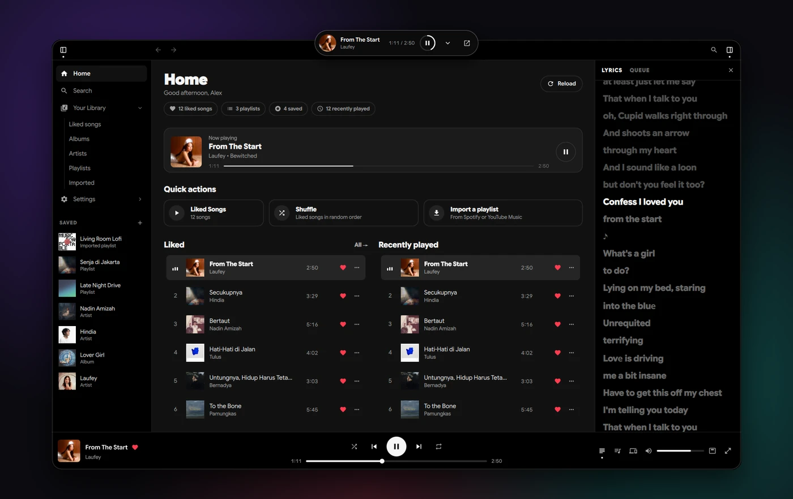
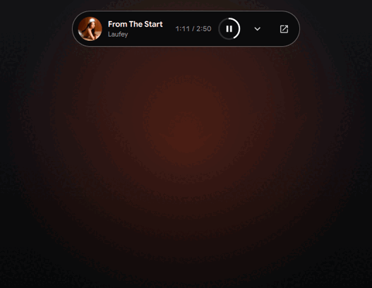
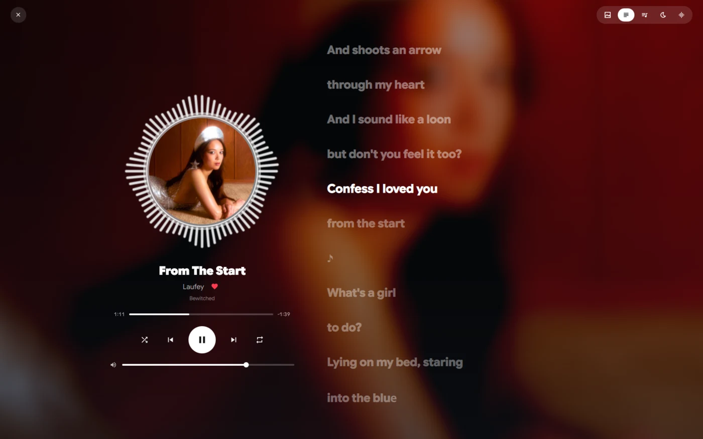
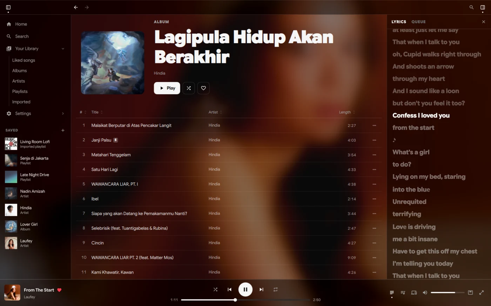
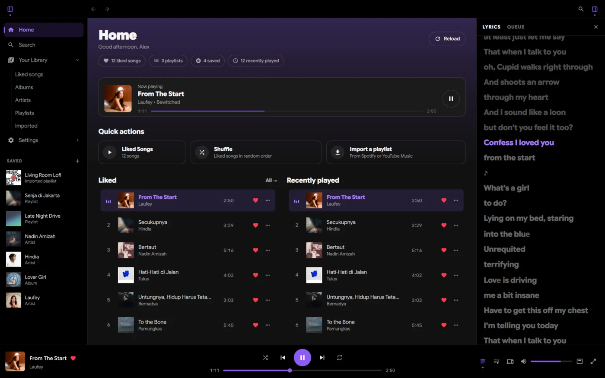
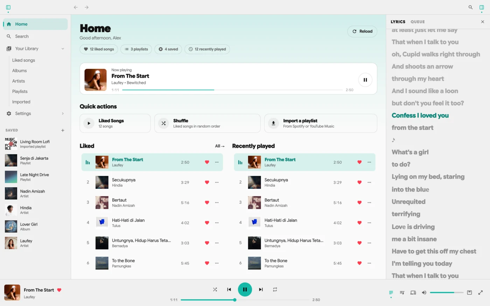
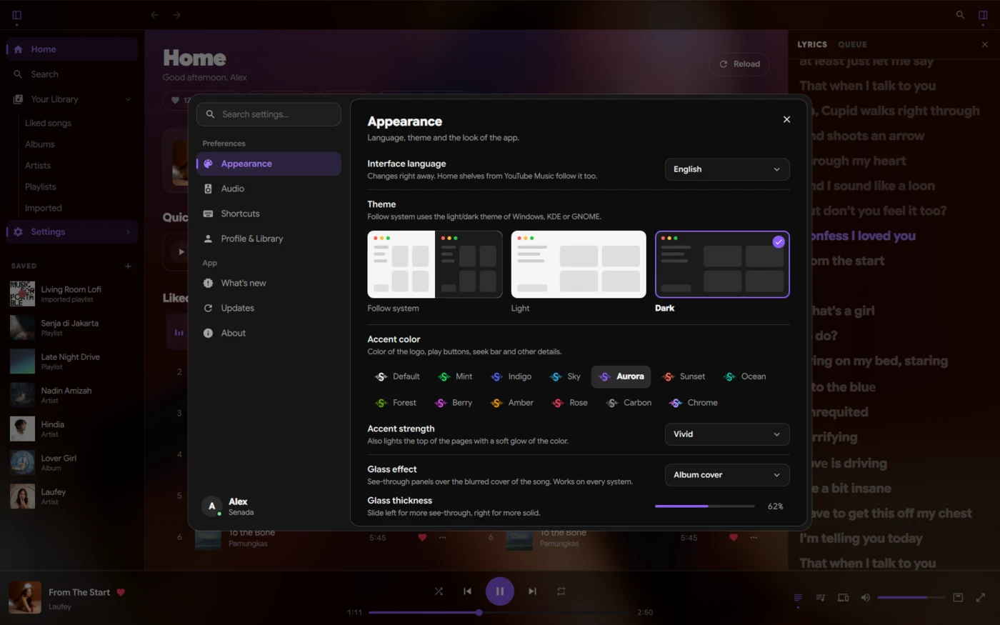

<div align="center">


# Senada

### Your music. No account, no ads.

A free desktop music player for **Windows & Linux**, powered by the YouTube Music catalog.
<br>
*Musikmu, tanpa akun dan tanpa iklan. Pemutar musik desktop gratis untuk Windows & Linux.*

[](https://github.com/Zeeynrs/Senada-FreeVersion/releases/latest)
[](https://github.com/Zeeynrs/Senada-FreeVersion/releases)
[](LICENSE)


[](https://github.com/Zeeynrs/Senada-FreeVersion/releases/latest)
&nbsp;
[](#en-linux)

**[English](#english)** · **[Bahasa Indonesia](#bahasa-indonesia)**

<br>



</div>

<br>

<table>
  <tr>
    <td width="50%" valign="top">
      <h3>🏝️ Dynamic island</h3>
      <p>Minimize Senada and a small player waits at the top of your screen: the song, its time and play / pause. Tap the arrow to open it wide, with the controls and the lyrics.</p>
      <p><i>Minimalkan Senada, dan pemutar kecil menunggu di atas layar. Klik panahnya untuk membuka kontrol dan lirik.</i></p>
    </td>
    <td width="50%" align="center"></td>
  </tr>
</table>

<table>
  <tr>
    <td width="50%"><p align="center"><b>Full-screen player</b> · <i>Player layar penuh</i><br><sub>Cover inside a live visualizer, synced lyrics</sub></p></td>
    <td width="50%"><p align="center"><b>Glass effect</b> · <i>Efek kaca</i><br><sub>The album art glows behind see-through panels</sub></p></td>
  </tr>
  <tr>
    <td width="50%"><p align="center"><b>Accent colors</b> · <i>Warna aksen</i><br><sub>12 colors, or the classic black & white</sub></p></td>
    <td width="50%"><p align="center"><b>Light & dark</b> · <i>Terang & gelap</i><br><sub>Follows your system, or pick one</sub></p></td>
  </tr>
  <tr>
    <td colspan="2" align="center"><p align="center"><b>Settings</b> · <i>Pengaturan</i><br><sub>Searchable, with a What's new log of every version</sub></p></td>
  </tr>
</table>

---

<a id="english"></a>

## English

> [**Download for Windows**](#en-windows) · [**Install on Linux**](#en-linux) · [Features](#en-features) · [How to use](#en-usage) · [Troubleshooting](#en-troubleshooting) · [For developers](#en-dev) · [Baca dalam Bahasa Indonesia ↓](#bahasa-indonesia)

<a id="en-features"></a>

### Why Senada?

<table>
  <tr>
    <td width="33%" valign="top"><h4>🎧 No account, no ads</h4>Open it and play. No Spotify Premium, no login, no cookies. Audio is played by MPV, so YouTube's ad player is never loaded.</td>
    <td width="33%" valign="top"><h4>📥 Bring your playlists</h4>Paste a link to a Spotify or YouTube Music playlist or album and the whole thing is copied into your library.</td>
    <td width="33%" valign="top"><h4>🎤 Synced lyrics</h4>Lines light up as they are sung, in the side panel, the full-screen player and the mini player. Click a line to jump there.</td>
  </tr>
  <tr>
    <td valign="top"><h4>🏝️ Mini player</h4>A dynamic island at the top of the screen while Senada is minimized, or any time with <code>Ctrl+M</code>.</td>
    <td valign="top"><h4>🎨 Make it yours</h4>12 accent colors, light and dark themes, a glass effect, a live visualizer, and English or Indonesian.</td>
    <td valign="top"><h4>💾 Stays on your computer</h4>Liked songs, playlists and history are stored locally. The Windows version updates itself.</td>
  </tr>
</table>

<details>
<summary><b>Everything Senada can do</b></summary>

**Music**
- Home, search, albums, artists and playlists from the **YouTube Music** catalog: new releases, trending, charts and community mixes.
- **Import** public playlists and albums from **Spotify** (each song is matched on YouTube Music) and from **YouTube Music** (songs play right away).
- **Radio**: right-click a song → *Play radio from this song*.
- **Offline songs**: download a song, playlist or album and play it without internet, with its cover and lyrics (*right-click → Download for offline*).
- **Synced lyrics** from LRCLIB, YouTube Music or NetEase. Pick the source in *Settings → Lyrics* or from the button under the lyrics; *Automatic* tries all three in turn.
- The next song is prepared in advance, so songs change without a gap.
- If a song will not play, Senada tries another upload of it, and otherwise moves on: the queue never gets stuck.

**Your library**
- Liked songs, your own playlists, saved albums / artists / playlists and history.
- Stored on your computer: `%APPDATA%\Senada\library.json` (Windows) or `~/.config/senada/library.json` (Linux).

**Look and feel**
- English (default) and Indonesian, switched without a restart.
- Light and dark themes that follow Windows, KDE or GNOME, or that you pick yourself.
- 12 accent colors: Mint, Indigo, Sky, Aurora, Sunset, Ocean, Forest, Berry, Amber, Rose, Carbon and Chrome.
- Collapsible sidebar, a side panel for lyrics or the queue, and track lists you can sort by column.
- **Full-screen player** in four styles (*Settings → Appearance*): round cover inside a circular visualizer (*cava*), a spinning **vinyl record** with a tonearm, a magazine **poster**, or a **cinema** screen with the lyrics as subtitles, each with its own lyrics, queue and equalizer.
- **Equalizer** (six bands and presets) and **tempo** with or without keeping the pitch, applied to the sound as it plays.
- **Seek bar styles**: a line, a wave, a waveform or dots.
- **Mini player** ("dynamic island") while Senada is minimized, in four styles: classic, sound wave, running lyrics or cover glass.
- **Glass effect** (optional): *Album cover* (every system) or *Transparent* (acrylic on Windows 11, blur on Hyprland / KDE).
- Settings with search, and a **What's new** page with the version on your computer and the changes in each release.

**Fits your desktop**
- Windows: one-click installer with automatic updates.
- Linux: MPRIS (`playerctl`, media keys, Hyprlock, Waybar), Wayland / Hyprland and X11.
- **Discord Rich Presence** (optional, *Settings → Discord*): "Listening to Senada" with the song, cover and a progress bar on your profile.

</details>

### Install

<a id="en-windows"></a>

#### 🪟 Windows 10 / 11

1. Download **`Senada-Setup-<version>.exe`** from the [**latest release**](https://github.com/Zeeynrs/Senada-FreeVersion/releases/latest).
2. Run it. If *"Windows protected your PC"* (SmartScreen) appears, click **More info → Run anyway**: the installer is not signed with a code-signing certificate yet.
3. Choose **Install for me only** (no admin rights needed) and follow the wizard.
4. Open **Senada** from the Start menu.

Everything is included: Python, PySide6, **mpv**, **yt-dlp** and **deno** (which yt-dlp needs for YouTube). Senada goes to `%LOCALAPPDATA%\Programs\Senada`.

**Updates** — Senada looks for a new release when it opens and every 6 hours (or *Settings → Updates → Check for updates*). Click **Update**: the installer is downloaded, checked (size and SHA-256) and installed, and Senada opens again by itself.

**Uninstall** — *Windows Settings → Apps → Senada → Uninstall*. Your library and settings in `%APPDATA%\Senada` are kept.

<a id="en-linux"></a>

#### 🐧 Linux

**Quick install (every distro, recommended):**

```bash
curl -fsSL https://raw.githubusercontent.com/Zeeynrs/Senada-FreeVersion/main/install.sh | bash
```

The script installs what Senada needs with your package manager (pacman, apt, dnf, zypper, xbps, apk), then adds the `senada` command and a menu entry. Remove it any time with `./install.sh --uninstall`.

<details>
<summary><b>Manual clone</b></summary>

```bash
git clone https://github.com/Zeeynrs/Senada-FreeVersion.git
cd Senada-FreeVersion
./install.sh
```
</details>

<details>
<summary><b>Arch Linux & derivatives</b> (EndeavourOS, CachyOS, Manjaro, …)</summary>

```bash
git clone https://github.com/Zeeynrs/Senada-FreeVersion.git
cd Senada-FreeVersion
makepkg -si
```
</details>

Start it with `senada` or from your app launcher (Rofi, Wofi, tofi, KDE, GNOME, …).

<a id="en-usage"></a>

### How to use

1. Open Senada: you land on Home, no login screen.
2. **Search** songs, artists, albums or playlists (`Ctrl+F`). You can also paste a YouTube Music or Spotify link there.
3. Click **♡** in the player bar to keep a song in *Liked Songs*, or **♡** on an album / playlist / artist page to save it to your library.
4. Make a playlist with the **+** in the sidebar, or right-click a song → *Add to playlist*.

#### Bring your playlists

Open **Library → Import playlist** (or *Settings → Profile & Library*), paste a link and click **Import**. The playlist appears in the sidebar.

| From | Link | What happens |
| :--- | :--- | :--- |
| **YouTube Music** / YouTube | `music.youtube.com/playlist?list=…`, an album link, or a song link copied while playing from a playlist | Copied as it is; songs play right away. Up to 5,000 songs. |
| **Spotify** | `open.spotify.com/playlist/…` or `…/album/…` | Each song is matched on YouTube Music in the background. Up to 10,000 songs. |

The playlist must be **public** (or unlisted on YouTube). *Liked Songs* on Spotify or YouTube Music are private, so they cannot be read without a login: copy those songs into a public playlist and import that.

For Spotify imports, title, artist and length are compared, and other versions (live, cover, karaoke, remix, slowed / sped up) are avoided unless that is what the song is. A song Senada is unsure about gets a **?** mark: click it (or right-click → *Pick another version…*) to see every candidate with its score, listen to them and pick the right one. Your choice is remembered.

#### Mini player

Minimize Senada while a song plays and the mini player appears at the top centre of the screen. The arrow opens it wider with the seek bar, previous / next and the lyrics; the open button next to it (or a double-click) brings Senada back. Drag it to move it. The button next to *Full screen* in the player bar, or `Ctrl+M`, opens it any time; on Hyprland, which has no minimize, that is the way to get it. Turn it off in *Settings → Appearance → Mini player*.

#### Keyboard shortcuts

| Key | Action |
| :--- | :--- |
| `Space` | Play / pause |
| `Ctrl+→` / `Ctrl+←` | Next / previous song |
| `Ctrl+↑` / `Ctrl+↓` | Volume up / down |
| `Ctrl+L` | Open / close the full-screen player |
| `Ctrl+M` | Mini player |
| `Ctrl+F` | Search |
| `Ctrl+B` | Show / hide the sidebar |
| `Alt+←` / `Alt+→` | Back / forward |
| `Ctrl+,` | Settings |
| `Ctrl+Q` | Quit |

<a id="en-troubleshooting"></a>

### Troubleshooting

<details>
<summary><b>Songs will not play</b></summary>

Senada streams audio from YouTube with `yt-dlp`.
- *"YouTube is limiting requests from this network for now"* / *"Sign in to confirm you're not a bot"*: YouTube is temporarily limiting your network. Wait a while, or try another network or a VPN.
- If YouTube changed something recently, update `yt-dlp`:
  - Windows (installer): `"%LOCALAPPDATA%\Programs\Senada\bin\yt-dlp.exe" -U`
  - Linux: with your package manager, or `yt-dlp -U`
- Still silent? **Settings → About → Logs → Open folder** shows `senada.log` and `mpv.log`; attach them when you report the problem.
</details>

<details>
<summary><b>Windows will not open the installer</b></summary>

Click **More info → Run anyway** on the SmartScreen prompt.
</details>

<details>
<summary><b>Where is my data?</b></summary>

| | Windows | Linux |
| :--- | :--- | :--- |
| Library & settings | `%APPDATA%\Senada` | `~/.config/senada` |
| Offline songs | `%USERPROFILE%\Music\Senada` | `~/Music/Senada` |
| Cache | `%LOCALAPPDATA%\Senada\Cache` | `~/.cache/senada` |
| Logs | `%LOCALAPPDATA%\Senada\logs` | `~/.cache/senada/logs` |
</details>

### Senada vs Nada

| | Nada | Senada |
| :--- | :--- | :--- |
| **Account** | Needs Spotify Premium | **None at all** |
| **Ads** | Depends on the Spotify account | **None** |
| **Catalog** | Spotify | **YouTube Music** (+ Spotify & YouTube Music playlist import) |
| **Library** | Spotify account | **On your computer** |
| **Audio engine** | `librespot` (Spotify Connect) | **MPV + yt-dlp** |
| **Lyrics & visualizer** | LRCLIB & cava | LRCLIB / YouTube Music / NetEase & cava |

<a id="en-dev"></a>

### For developers

Senada is Python + Qt Quick (PySide6 / QML). App code is in `senada/`, the interface in `qml/`, Windows packaging in `packaging/windows/`.

<details>
<summary><b>Run from source on Windows</b></summary>

1. Install **Python 3.11+** from [python.org](https://www.python.org/downloads/) (tick *Add python.exe to PATH*).
2. `git clone https://github.com/Zeeynrs/Senada-FreeVersion.git`
3. Put `mpv.exe` and `yt-dlp.exe` in `bin\`, or install them with [Scoop](https://scoop.sh): `scoop bucket add extras`, then `scoop install mpv yt-dlp`.
4. Double-click **`senada.bat`**. The first time, it creates `.venv` and installs PySide6.

This copy updates with the *Update* button in the app (through `git`, needs Git for Windows). MPRIS does not exist on Windows; the visualizer needs `cava.exe` in `bin\` (optional).
</details>

<details>
<summary><b>Tests</b></summary>

```bash
python -m unittest discover -s tests
```
</details>

<details>
<summary><b>Build the Windows installer</b></summary>

Needs Python 3.11+ and [Inno Setup 6](https://jrsoftware.org/isinfo.php) (`winget install JRSoftware.InnoSetup`):

```powershell
powershell -ExecutionPolicy Bypass -File packaging\windows\build.ps1
```

The result is `packaging\windows\dist\Senada-Setup-<version>.exe`. Add `-SkipInstaller` for just the portable `dist\Senada\` folder.
</details>

<details>
<summary><b>Release a new version</b></summary>

1. Raise `__version__` in `senada/__init__.py`, and move the *next* entry in `senada/changelog.py` (the *What's new* page) to the new version. Commit.
2. `git tag v<version>` and `git push origin v<version>`.
3. The [`windows-installer.yml`](.github/workflows/windows-installer.yml) workflow builds the installer and attaches it to the release. Installed copies offer the update by themselves.
</details>

<details>
<summary><b>Code signing (optional)</b></summary>

When one of these is set, `build.ps1` signs `Senada.exe`, the installer and the uninstaller (SHA-256 + timestamp) with `packaging\windows\sign.ps1`:

| Variable | Value |
| :--- | :--- |
| `SENADA_SIGN_PFX` | path to the `.pfx` certificate |
| `SENADA_SIGN_PFX_BASE64` | the `.pfx` in base64 (for GitHub Actions secrets) |
| `SENADA_SIGN_THUMBPRINT` | certificate thumbprint in `Cert:\CurrentUser\My` |
| `SENADA_SIGN_PASSWORD` | `.pfx` password |

On GitHub Actions, add the `SENADA_SIGN_PFX_BASE64` and `SENADA_SIGN_PASSWORD` secrets. Without them the installer is still built, just unsigned.
</details>

### License

[GNU General Public License v3.0](LICENSE).

---

<a id="bahasa-indonesia"></a>

## Bahasa Indonesia

> [**Unduh untuk Windows**](#id-windows) · [**Pasang di Linux**](#id-linux) · [Fitur](#id-fitur) · [Cara pakai](#id-cara-pakai) · [Pemecahan masalah](#id-masalah) · [Untuk pengembang](#id-pengembang) · [Read in English ↑](#english)

<a id="id-fitur"></a>

### Kenapa Senada?

<table>
  <tr>
    <td width="33%" valign="top"><h4>🎧 Tanpa akun, tanpa iklan</h4>Buka lalu putar. Tidak perlu Spotify Premium, login, atau cookie. Audio diputar oleh MPV, jadi pemutar iklan YouTube tidak pernah dimuat.</td>
    <td width="33%" valign="top"><h4>📥 Bawa playlist-mu</h4>Tempel link playlist atau album Spotify maupun YouTube Music, dan seluruh isinya disalin ke library-mu.</td>
    <td width="33%" valign="top"><h4>🎤 Lirik tersinkron</h4>Baris lirik menyala saat dinyanyikan, di panel samping, player layar penuh, dan pemutar mini. Klik satu baris untuk lompat ke sana.</td>
  </tr>
  <tr>
    <td valign="top"><h4>🏝️ Pemutar mini</h4>Dynamic island di atas layar saat Senada diminimalkan, atau kapan saja dengan <code>Ctrl+M</code>.</td>
    <td valign="top"><h4>🎨 Sesuai seleramu</h4>12 warna aksen, tema terang dan gelap, efek kaca, visualizer, serta bahasa Inggris atau Indonesia.</td>
    <td valign="top"><h4>💾 Tetap di komputermu</h4>Lagu disukai, playlist, dan riwayat disimpan di komputermu. Versi Windows memperbarui dirinya sendiri.</td>
  </tr>
</table>

<details>
<summary><b>Semua yang bisa dilakukan Senada</b></summary>

**Musik**
- Beranda, pencarian, album, artis, dan playlist dari katalog **YouTube Music**: rilis baru, trending, tangga lagu, dan mix komunitas.
- **Impor** playlist dan album publik dari **Spotify** (setiap lagu dicocokkan di YouTube Music) dan dari **YouTube Music** (lagu langsung bisa diputar).
- **Radio**: klik kanan lagu → *Putar radio dari lagu ini*.
- **Lagu offline**: unduh lagu, playlist, atau album lalu putar tanpa internet, lengkap dengan sampul dan liriknya (*klik kanan → Unduh untuk offline*).
- **Lirik tersinkron** dari LRCLIB, YouTube Music, atau NetEase. Pilih sumbernya di *Pengaturan → Lirik* atau dari tombol di bawah lirik; *Otomatis* mencoba ketiganya bergantian.
- Lagu berikutnya disiapkan lebih dulu, jadi perpindahan lagu tanpa jeda.
- Kalau sebuah lagu gagal diputar, Senada mencoba versi unggahan lain, atau melewatinya: antrean tidak pernah macet.

**Library-mu**
- Lagu disukai, playlist buatan sendiri, album / artis / playlist yang disimpan, dan riwayat putar.
- Tersimpan di komputermu: `%APPDATA%\Senada\library.json` (Windows) atau `~/.config/senada/library.json` (Linux).

**Tampilan**
- Bahasa Inggris (bawaan) dan Indonesia, diganti tanpa mulai ulang.
- Tema terang dan gelap yang mengikuti Windows, KDE, atau GNOME, atau dipilih sendiri.
- 12 warna aksen: Mint, Indigo, Langit, Aurora, Senja, Samudra, Hutan, Beri, Amber, Mawar, Karbon, dan Krom.
- Sidebar yang bisa disembunyikan, panel samping untuk lirik atau antrean, dan daftar lagu yang bisa diurutkan per kolom.
- **Player layar penuh** dengan empat gaya (*Pengaturan → Tampilan*): sampul bulat di tengah visualizer melingkar (*cava*), **piringan hitam** yang berputar dengan lengan jarum, **poster** majalah, atau **layar bioskop** dengan lirik sebagai subtitle, masing-masing dengan lirik, antrean, dan equalizer sendiri.
- **Equalizer** (enam pita dan preset) dan **tempo** dengan atau tanpa mempertahankan nada, langsung diterapkan ke suara.
- **Gaya bilah progres**: garis, gelombang, bentuk gelombang, atau titik-titik.
- **Pemutar mini** ("dynamic island") saat Senada diminimalkan, dengan empat gaya: klasik, gelombang suara, lirik berjalan, atau kaca sampul.
- **Efek kaca** (opsional): *Sampul album* (semua sistem) atau *Transparan* (acrylic di Windows 11, blur di Hyprland / KDE).
- Pengaturan dengan kolom cari, dan halaman **Apa yang baru** berisi versi di komputermu serta perubahan di setiap rilis.

**Menyatu dengan desktop**
- Windows: installer sekali klik dengan pembaruan otomatis.
- Linux: MPRIS (`playerctl`, tombol media, Hyprlock, Waybar), Wayland / Hyprland dan X11.
- **Discord Rich Presence** (opsional, *Pengaturan → Discord*): "Listening to Senada" beserta lagu, sampul, dan bilah progres di profilmu.

</details>

### Instalasi

<a id="id-windows"></a>

#### 🪟 Windows 10 / 11

1. Unduh **`Senada-Setup-<versi>.exe`** dari [**rilis terbaru**](https://github.com/Zeeynrs/Senada-FreeVersion/releases/latest).
2. Jalankan. Kalau muncul *"Windows protected your PC"* (SmartScreen), klik **More info → Run anyway**: installer-nya belum ditandatangani dengan sertifikat code signing.
3. Pilih **Install for me only** (tidak perlu hak admin) dan ikuti wizard-nya.
4. Buka **Senada** dari Start menu.

Semua sudah termasuk: Python, PySide6, **mpv**, **yt-dlp**, dan **deno** (yang dibutuhkan yt-dlp untuk YouTube). Senada dipasang di `%LOCALAPPDATA%\Programs\Senada`.

**Pembaruan** — Senada mencari rilis baru saat dibuka dan setiap 6 jam (atau *Pengaturan → Pembaruan → Periksa Pembaruan*). Klik **Perbarui**: installer diunduh, diperiksa (ukuran dan SHA-256), lalu dipasang, dan Senada terbuka lagi dengan sendirinya.

**Menghapus** — *Settings Windows → Apps → Senada → Uninstall*. Library dan pengaturan di `%APPDATA%\Senada` tetap disimpan.

<a id="id-linux"></a>

#### 🐧 Linux

**Instalasi cepat (semua distro, direkomendasikan):**

```bash
curl -fsSL https://raw.githubusercontent.com/Zeeynrs/Senada-FreeVersion/main/install.sh | bash
```

Skrip ini memasang yang dibutuhkan Senada lewat package manager-mu (pacman, apt, dnf, zypper, xbps, apk), lalu menambahkan perintah `senada` dan entri di menu aplikasi. Hapus kapan saja dengan `./install.sh --uninstall`.

<details>
<summary><b>Clone manual</b></summary>

```bash
git clone https://github.com/Zeeynrs/Senada-FreeVersion.git
cd Senada-FreeVersion
./install.sh
```
</details>

<details>
<summary><b>Arch Linux & turunannya</b> (EndeavourOS, CachyOS, Manjaro, …)</summary>

```bash
git clone https://github.com/Zeeynrs/Senada-FreeVersion.git
cd Senada-FreeVersion
makepkg -si
```
</details>

Jalankan dengan `senada` atau dari app launcher (Rofi, Wofi, tofi, KDE, GNOME, …).

<a id="id-cara-pakai"></a>

### Cara pakai

1. Buka Senada: langsung masuk ke Beranda, tanpa layar login.
2. **Cari** lagu, artis, album, atau playlist (`Ctrl+F`). Link YouTube Music atau Spotify juga bisa ditempel di sana.
3. Klik **♡** di bilah pemutar untuk menyimpan lagu ke *Lagu yang Disukai*, atau **♡** di halaman album / playlist / artis untuk menyimpannya ke library.
4. Buat playlist dengan tombol **+** di sidebar, atau klik kanan lagu → *Tambah ke playlist*.

#### Bawa playlist-mu

Buka **Library → Impor playlist** (atau *Pengaturan → Profil & Library*), tempel link, lalu klik **Impor**. Playlist-nya muncul di sidebar.

| Dari | Link | Yang terjadi |
| :--- | :--- | :--- |
| **YouTube Music** / YouTube | `music.youtube.com/playlist?list=…`, link album, atau link lagu yang disalin saat diputar dari playlist | Disalin apa adanya; lagu langsung bisa diputar. Sampai 5.000 lagu. |
| **Spotify** | `open.spotify.com/playlist/…` atau `…/album/…` | Setiap lagu dicocokkan dengan YouTube Music di latar belakang. Sampai 10.000 lagu. |

Playlist-nya harus **publik** (atau tidak publik/unlisted di YouTube). *Lagu yang Disukai* di Spotify maupun YouTube Music bersifat privat, jadi tidak bisa dibaca tanpa login: salin lagu-lagunya ke playlist publik lalu impor playlist itu.

Untuk impor dari Spotify, judul, artis, dan durasi dibandingkan, dan versi lain (live, cover, karaoke, remix, slowed / sped up) dihindari kecuali lagunya memang begitu. Lagu yang pencocokannya kurang yakin diberi tanda **?**: klik tanda itu (atau klik kanan → *Pilih versi lain…*) untuk melihat semua kandidat beserta skornya, mencobanya, dan memilih yang benar. Pilihanmu diingat.

#### Pemutar mini

Minimalkan Senada saat lagu diputar, dan pemutar mini muncul di tengah atas layar. Panahnya membuka island lebih lebar dengan bilah lagu, tombol sebelumnya / berikutnya, dan lirik; tombol buka di sebelahnya (atau klik dua kali) membuka Senada lagi. Seret untuk memindahkannya. Tombol di sebelah *Layar penuh* di bilah pemutar, atau `Ctrl+M`, membukanya kapan saja; di Hyprland, yang tidak punya minimize, pakai cara ini. Matikan di *Pengaturan → Tampilan → Pemutar mini*.

#### Pintasan keyboard

| Tombol | Aksi |
| :--- | :--- |
| `Space` | Putar / jeda |
| `Ctrl+→` / `Ctrl+←` | Lagu berikutnya / sebelumnya |
| `Ctrl+↑` / `Ctrl+↓` | Volume naik / turun |
| `Ctrl+L` | Buka / tutup player layar penuh |
| `Ctrl+M` | Pemutar mini |
| `Ctrl+F` | Cari |
| `Ctrl+B` | Tampilkan / sembunyikan sidebar |
| `Alt+←` / `Alt+→` | Kembali / maju |
| `Ctrl+,` | Pengaturan |
| `Ctrl+Q` | Keluar |

<a id="id-masalah"></a>

### Pemecahan masalah

<details>
<summary><b>Lagu tidak bisa diputar</b></summary>

Senada memutar audio dari YouTube lewat `yt-dlp`.
- *"YouTube sedang membatasi permintaan dari jaringan ini"* / *"Sign in to confirm you're not a bot"*: YouTube sedang membatasi jaringanmu untuk sementara. Tunggu sebentar, atau coba jaringan lain atau VPN.
- Kalau YouTube baru mengubah sesuatu, perbarui `yt-dlp`:
  - Windows (installer): `"%LOCALAPPDATA%\Programs\Senada\bin\yt-dlp.exe" -U`
  - Linux: lewat package manager-mu, atau `yt-dlp -U`
- Masih tidak ada suara? **Pengaturan → Tentang → Log → Buka folder** berisi `senada.log` dan `mpv.log`; lampirkan saat melaporkan masalah.
</details>

<details>
<summary><b>Windows menolak membuka installer</b></summary>

Klik **More info → Run anyway** pada layar SmartScreen.
</details>

<details>
<summary><b>Data-ku disimpan di mana?</b></summary>

| | Windows | Linux |
| :--- | :--- | :--- |
| Library & pengaturan | `%APPDATA%\Senada` | `~/.config/senada` |
| Lagu offline | `%USERPROFILE%\Music\Senada` | `~/Music/Senada` |
| Cache | `%LOCALAPPDATA%\Senada\Cache` | `~/.cache/senada` |
| Log | `%LOCALAPPDATA%\Senada\logs` | `~/.cache/senada/logs` |
</details>

### Senada vs Nada

| | Nada | Senada |
| :--- | :--- | :--- |
| **Akun** | Butuh Spotify Premium | **Tidak perlu sama sekali** |
| **Iklan** | Tergantung akun Spotify | **Tidak ada** |
| **Katalog** | Spotify | **YouTube Music** (+ impor playlist Spotify & YouTube Music) |
| **Library** | Akun Spotify | **Di komputermu** |
| **Mesin audio** | `librespot` (Spotify Connect) | **MPV + yt-dlp** |
| **Lirik & visualizer** | LRCLIB & cava | LRCLIB / YouTube Music / NetEase & cava |

<a id="id-pengembang"></a>

### Untuk pengembang

Senada ditulis dengan Python + Qt Quick (PySide6 / QML). Kode aplikasi ada di `senada/`, antarmuka di `qml/`, dan packaging Windows di `packaging/windows/`.

<details>
<summary><b>Menjalankan dari kode sumber di Windows</b></summary>

1. Pasang **Python 3.11+** dari [python.org](https://www.python.org/downloads/) (centang *Add python.exe to PATH*).
2. `git clone https://github.com/Zeeynrs/Senada-FreeVersion.git`
3. Taruh `mpv.exe` dan `yt-dlp.exe` di `bin\`, atau pasang lewat [Scoop](https://scoop.sh): `scoop bucket add extras`, lalu `scoop install mpv yt-dlp`.
4. Klik dua kali **`senada.bat`**. Saat pertama kali, skrip ini membuat `.venv` dan memasang PySide6.

Salinan ini diperbarui lewat tombol *Perbarui* di aplikasi (lewat `git`, butuh Git for Windows). MPRIS tidak ada di Windows; visualizer butuh `cava.exe` di `bin\` (opsional).
</details>

<details>
<summary><b>Tes</b></summary>

```bash
python -m unittest discover -s tests
```
</details>

<details>
<summary><b>Membangun installer Windows</b></summary>

Butuh Python 3.11+ dan [Inno Setup 6](https://jrsoftware.org/isinfo.php) (`winget install JRSoftware.InnoSetup`):

```powershell
powershell -ExecutionPolicy Bypass -File packaging\windows\build.ps1
```

Hasilnya `packaging\windows\dist\Senada-Setup-<versi>.exe`. Tambahkan `-SkipInstaller` untuk folder portabel `dist\Senada\` saja.
</details>

<details>
<summary><b>Merilis versi baru</b></summary>

1. Naikkan `__version__` di `senada/__init__.py`, dan pindahkan entri *next* di `senada/changelog.py` (halaman *Apa yang baru*) ke versi baru. Commit.
2. `git tag v<versi>` dan `git push origin v<versi>`.
3. Workflow [`windows-installer.yml`](.github/workflows/windows-installer.yml) membangun installer dan melampirkannya ke rilis. Aplikasi yang sudah terpasang menawarkan pembaruan dengan sendirinya.
</details>

<details>
<summary><b>Code signing (opsional)</b></summary>

Kalau salah satu variabel ini di-set, `build.ps1` menandatangani `Senada.exe`, installer, dan uninstaller (SHA-256 + timestamp) lewat `packaging\windows\sign.ps1`:

| Variabel | Isi |
| :--- | :--- |
| `SENADA_SIGN_PFX` | path ke sertifikat `.pfx` |
| `SENADA_SIGN_PFX_BASE64` | isi `.pfx` dalam base64 (untuk secret GitHub Actions) |
| `SENADA_SIGN_THUMBPRINT` | thumbprint sertifikat di `Cert:\CurrentUser\My` |
| `SENADA_SIGN_PASSWORD` | password `.pfx` |

Di GitHub Actions, tambahkan secret `SENADA_SIGN_PFX_BASE64` dan `SENADA_SIGN_PASSWORD`. Tanpa secret itu installer tetap dibangun, hanya tidak ditandatangani.
</details>

### Lisensi

[GNU General Public License v3.0](LICENSE).
