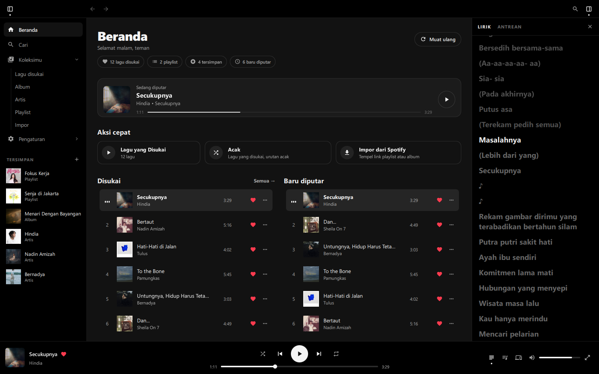
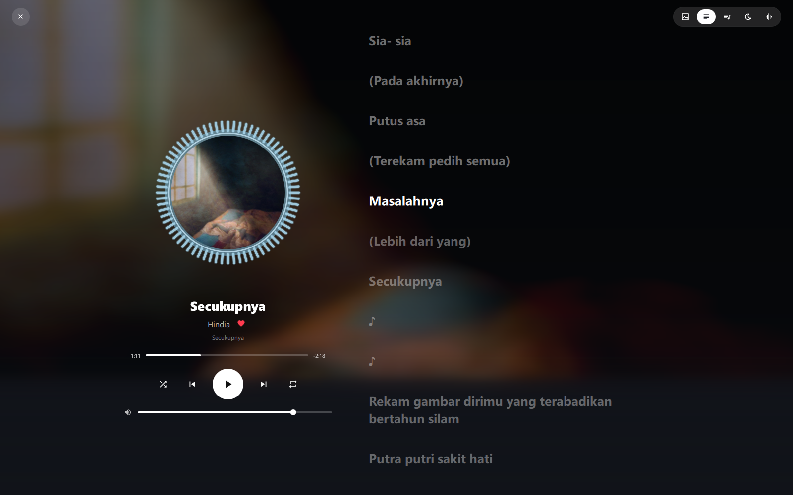
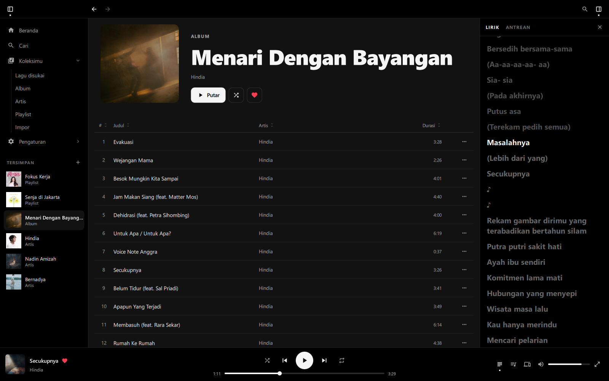
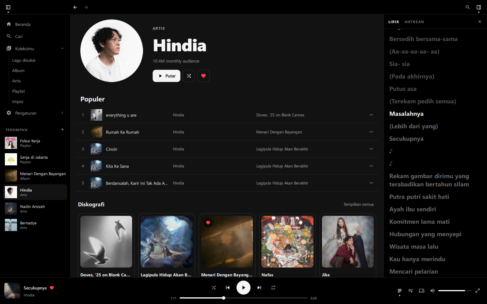
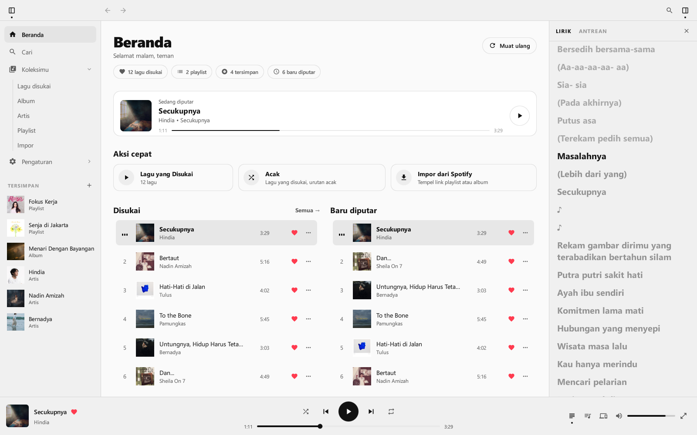
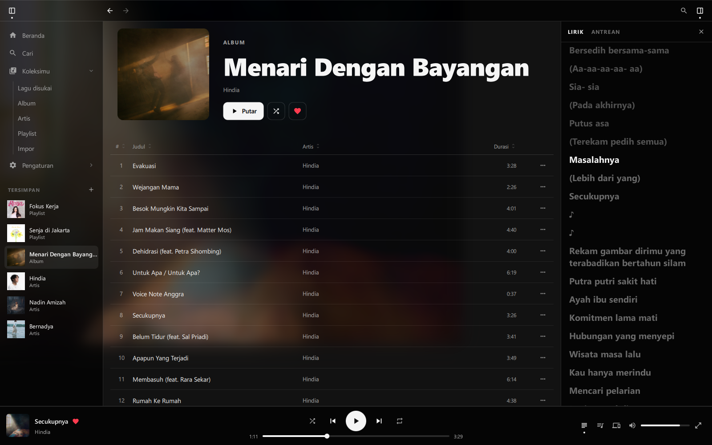

<div align="center">


# Senada

**Free, ad-free, account-free music player for Windows & Linux.**
<br>
*Pemutar musik gratis, bebas iklan, dan tanpa akun untuk Windows & Linux.*

Catalog from YouTube Music, library stored locally on your computer, audio played directly via MPV.
<br>
*Katalog dari YouTube Music, library tersimpan di komputermu sendiri, audio diputar langsung lewat MPV.*

[](https://github.com/Zeeynrs/Senada-FreeVersion/releases/latest)
[](LICENSE)


**Language / Bahasa:** [**English**](#english) · [**Bahasa Indonesia**](#bahasa-indonesia)



</div>

---

## Screenshots · Tangkapan Layar

<table>
  <tr>
    <td width="50%"><p align="center"><b>Immersive player · Player imersif</b><br>Cover inside circular visualizer, synced lyrics / Sampul di tengah visualizer, lirik tersinkron</p></td>
    <td width="50%"><p align="center"><b>Albums & playlists · Album & playlist</b><br>Sortable track table / Tabel lagu yang bisa diurutkan</p></td>
  </tr>
  <tr>
    <td width="50%"><p align="center"><b>Artist page · Halaman artis</b><br>Popular songs and discography / Lagu populer dan diskografi</p></td>
    <td width="50%"><p align="center"><b>Light theme · Tema terang</b><br>Follows system or choose manually / Ikut sistem atau pilih sendiri</p></td>
  </tr>
  <tr>
    <td colspan="2"><p align="center"><b>Glass effect · Efek kaca</b><br>Blurred album cover behind translucent panels / Sampul album yang diburamkan di balik panel tembus pandang</p></td>
  </tr>
</table>

---

<a id="english"></a>

## English

> [**Download for Windows**](#en-windows) · [**Install on Linux**](#en-linux) · [Features](#en-features) · [How to Use](#en-usage) · [Troubleshooting](#en-troubleshooting) · [For Developers](#en-dev) · [Baca dalam Bahasa Indonesia ↓](#bahasa-indonesia)

<a id="en-features"></a>

### Features

**No account, no ads**
- Open the app, search, and play right away — no Spotify Premium, Client ID, cookies, or login required.
- Audio is played directly by MPV, so the YouTube ad player is never loaded.

**Music**
- Home, search, albums, artists, and playlists from the **YouTube Music** catalog (new releases, trending, charts, community mixes).
- **Import from Spotify**: paste a public playlist or album link, and Senada matches each song on YouTube Music.
- **Radio**: right-click a song → *Play radio from this song*.
- **Synced lyrics** from LRCLIB, in both the right panel and the immersive player.
- Pre-fetching for the next track for fast transitions between songs.

**Local library**
- Liked songs, custom playlists, saved albums/artists/playlists, and playback history.
- Everything is stored locally on your computer: `%APPDATA%\Senada\library.json` (Windows) or `~/.config/senada/library.json` (Linux).

**Appearance**
- Interface available in **English** (default) and **Indonesian**.
- Dark and light themes that follow your system (Windows, KDE, GNOME) or can be chosen in Settings.
- Collapsible sidebar, right panel for lyrics or queue, and a table-style track list sortable by column.
- **Immersive player**: round cover inside a circular visualizer (*cava*), equalizer, tempo & pitch, queue, and lyrics.
- **Glass effect** (optional): *Album cover* (works on all systems) or *Transparent* (acrylic on Windows 11, Hyprland/KDE blur).
- Automatic accent color extracted from the song cover.

**System integration**
- Windows: one-click installer with automatic updates.
- Linux: MPRIS (`playerctl`, media keys, Hyprlock, Waybar), Wayland/Hyprland and X11.

### Installation

<a id="en-windows"></a>

#### Windows 10/11

1. Download **`Senada-Setup-<version>.exe`** from the [**Releases**](https://github.com/Zeeynrs/Senada-FreeVersion/releases/latest) page.
2. Run the installer. If *"Windows protected your PC"* (SmartScreen) appears, click **More info → Run anyway** — this warning appears because the installer is not yet signed with a code signing certificate.
3. Choose **Install for me only** (no admin rights needed), then follow the wizard until completion.
4. Launch **Senada** from the Start Menu.

The installer already bundles everything needed: Python, PySide6, **mpv**, **yt-dlp**, and **deno** (the JavaScript runtime required by yt-dlp for YouTube). Senada is installed in `%LOCALAPPDATA%\Programs\Senada`.

**Automatic updates** — Senada checks for the latest release on startup, then every 6 hours (or via *Settings → Check for updates*). When a new version is available, click **Update**: the installer is downloaded and verified (size & SHA-256), installed, and Senada relaunches automatically.

**Uninstall** — *Settings → Apps → Senada → Uninstall*. Your library and settings in `%APPDATA%\Senada` are preserved.

<a id="en-linux"></a>

#### Linux

**Quick install (all distros, recommended):**

```bash
curl -fsSL https://raw.githubusercontent.com/Zeeynrs/Senada-FreeVersion/main/install.sh | bash
```

This script installs dependencies using your distro's package manager (pacman, apt, dnf, zypper, xbps, apk), then creates the `senada` command and an application menu entry. Uninstall anytime with `./install.sh --uninstall`.

<details>
<summary><b>Manual clone</b></summary>

```bash
git clone https://github.com/Zeeynrs/Senada-FreeVersion.git
cd Senada-FreeVersion
./install.sh
```
</details>

<details>
<summary><b>Arch Linux & derivatives</b> (EndeavourOS, CachyOS, Manjaro, …)</summary>

```bash
git clone https://github.com/Zeeynrs/Senada-FreeVersion.git
cd Senada-FreeVersion
makepkg -si
```
</details>

Run using the `senada` command or from your app launcher (Rofi, Wofi, tofi, KDE, GNOME, …).

<a id="en-usage"></a>

### How to Use

1. Open Senada — you land straight on Home with no login screen.
2. **Search** for songs, artists, albums, or playlists (`Ctrl+F`). YouTube Music and Spotify links can also be pasted directly into the search bar.
3. Click **♡** on the player bar to save a song to *Liked Songs*, or **♡** on an album/playlist/artist page to save it to your Library.
4. Create a playlist via the **+** button in the sidebar, or right-click a song → *Add to playlist*.

#### Moving from Spotify

Open **Your Library → Import**, paste a **public** playlist or album link (e.g., `https://open.spotify.com/playlist/...`), and click **Import**. The playlist appears in the sidebar.

Senada then matches each track on YouTube Music in the background: title, artist, and duration are compared, while alternate versions (live, cover, karaoke, remix, slowed/sped up) are avoided unless that is what was requested. Songs with uncertain matches are marked with **?** — click the mark (or right-click → *Pick another version…*) to inspect all candidates with their scores, preview them, and pick the right one. Your choice is remembered.

The entire playlist is imported (up to Spotify's 10,000-track limit); large playlists take a few minutes to finish matching every song. Spotify's *Liked Songs* is private and cannot be imported directly — create a public playlist containing those songs, then import its link.

#### Keyboard shortcuts

| Key | Action |
| :--- | :--- |
| `Space` | Play / pause |
| `Ctrl+→` / `Ctrl+←` | Next / previous song |
| `Ctrl+↑` / `Ctrl+↓` | Volume up / down |
| `Ctrl+L` | Open / close immersive player |
| `Ctrl+F` | Search |
| `Ctrl+B` | Show / hide sidebar |
| `Alt+←` / `Alt+→` | Back / forward |
| `Ctrl+,` | Settings |
| `Ctrl+Q` | Quit |

<a id="en-troubleshooting"></a>

### Troubleshooting

**Songs fail to play.** Senada streams audio from YouTube via `yt-dlp`.
- If you see *"Sign in to confirm you're not a bot"* or YouTube is blocked on your network, try another network or a VPN.
- If YouTube recently changed its system, update `yt-dlp`:
  - Windows (installer): `"%LOCALAPPDATA%\Programs\Senada\bin\yt-dlp.exe" -U`
  - Linux: via your distro's package manager, or `yt-dlp -U`

**Windows refuses to open the installer.** Click **More info → Run anyway** on the SmartScreen prompt.

**Where is Senada's data stored?**

| | Windows | Linux |
| :--- | :--- | :--- |
| Library & settings | `%APPDATA%\Senada` | `~/.config/senada` |
| Cache | `%LOCALAPPDATA%\Senada\Cache` | `~/.cache/senada` |

### Senada vs Nada

| Feature | Nada | Senada |
| :--- | :--- | :--- |
| **Account requirement** | Requires Spotify Premium | **No account at all** |
| **Ads** | Depends on Spotify account | **Ad-free** |
| **Catalog** | Spotify | **YouTube Music** (+ public Spotify playlist import) |
| **Library** | Spotify account | **Local on device** |
| **Audio engine** | `librespot` (Spotify Connect) | **MPV + yt-dlp** |
| **Lyrics & visualizer** | LRCLIB & Cava | LRCLIB & Cava |

<a id="en-dev"></a>

### For Developers

Senada is written in Python + Qt Quick (PySide6/QML). Application code lives in `senada/`, UI in `qml/`, and Windows packaging in `packaging/windows/`.

<details>
<summary><b>Running from source on Windows</b></summary>

1. Install **Python 3.11+** from [python.org](https://www.python.org/downloads/) (check *Add python.exe to PATH*).
2. `git clone https://github.com/Zeeynrs/Senada-FreeVersion.git`
3. Place `mpv.exe` and `yt-dlp.exe` in the `bin\` folder, or install via [Scoop](https://scoop.sh): `scoop bucket add extras` then `scoop install mpv yt-dlp`.
4. Double-click **`senada.bat`**. On first launch, this script creates `.venv` and installs PySide6.

This version updates via the in-app *Update* button (uses `git`, requires Git for Windows). MPRIS is not available on Windows; the visualizer requires `cava.exe` in `bin\` (optional).
</details>

<details>
<summary><b>Tests</b></summary>

```bash
python -m unittest discover -s tests
```
</details>

<details>
<summary><b>Building the Windows installer</b></summary>

Requires Python 3.11+ and [Inno Setup 6](https://jrsoftware.org/isinfo.php) (`winget install JRSoftware.InnoSetup`):

```powershell
powershell -ExecutionPolicy Bypass -File packaging\windows\build.ps1
```

Outputs `packaging\windows\dist\Senada-Setup-<version>.exe`. Pass `-SkipInstaller` for the portable `dist\Senada\` folder only.
</details>

<details>
<summary><b>Releasing a new version</b></summary>

1. Bump `__version__` in `senada/__init__.py`, then commit.
2. `git tag v<version>` and `git push origin v<version>`.
3. The [`windows-installer.yml`](.github/workflows/windows-installer.yml) workflow builds the installer and attaches it to the Release. Installed apps will offer the update automatically.
</details>

<details>
<summary><b>Code signing (optional)</b></summary>

If any of the variables below are set, `build.ps1` signs `Senada.exe`, the installer, and the uninstaller (SHA-256 + timestamp) via `packaging\windows\sign.ps1`:

| Variable | Value |
| :--- | :--- |
| `SENADA_SIGN_PFX` | path to the `.pfx` certificate file |
| `SENADA_SIGN_PFX_BASE64` | base64-encoded `.pfx` content (for GitHub Actions secrets) |
| `SENADA_SIGN_THUMBPRINT` | certificate thumbprint in `Cert:\CurrentUser\My` |
| `SENADA_SIGN_PASSWORD` | `.pfx` password |

On GitHub Actions, add the `SENADA_SIGN_PFX_BASE64` and `SENADA_SIGN_PASSWORD` secrets. Without them, the installer is still built, just unsigned.
</details>

### License

Distributed under the [GNU General Public License v3.0](LICENSE).

---

<a id="bahasa-indonesia"></a>

## Bahasa Indonesia

> [**Unduh untuk Windows**](#id-windows) · [**Pasang di Linux**](#id-linux) · [Fitur](#id-fitur) · [Cara Pakai](#id-cara-pakai) · [Pemecahan Masalah](#id-masalah) · [Untuk Pengembang](#id-pengembang) · [Read in English ↑](#english)

<a id="id-fitur"></a>

### Fitur

**Tanpa akun, tanpa iklan**
- Buka aplikasi, langsung cari dan putar — tidak perlu Spotify Premium, Client ID, cookie, atau login.
- Audio diputar langsung oleh MPV, jadi pemutar iklan YouTube tidak pernah dimuat.

**Musik**
- Beranda, pencarian, album, artis, dan playlist dari katalog **YouTube Music** (rilis baru, trending, tangga lagu, mix komunitas).
- **Impor dari Spotify**: tempel link playlist/album publik, Senada mencocokkan setiap lagunya di YouTube Music.
- **Radio**: klik kanan lagu → *Putar radio dari lagu ini*.
- **Lirik tersinkron** dari LRCLIB, di panel kanan maupun di player imersif.
- Pre-fetching lagu berikutnya supaya perpindahan lagu cepat.

**Library lokal**
- Lagu disukai, playlist buatan sendiri, album/artis/playlist yang disimpan, dan riwayat putar.
- Semuanya tersimpan di komputermu: `%APPDATA%\Senada\library.json` (Windows) atau `~/.config/senada/library.json` (Linux).

**Tampilan**
- Bahasa antarmuka tersedia dalam **Inggris** (bawaan) dan **Indonesia**.
- Tema gelap dan terang yang mengikuti sistem (Windows, KDE, GNOME) atau dipilih di Pengaturan.
- Sidebar yang bisa disembunyikan, panel kanan untuk lirik atau antrean, dan daftar lagu berbentuk tabel yang bisa diurutkan per kolom.
- **Player imersif**: sampul bulat di tengah visualizer melingkar (*cava*), equalizer, tempo & pitch, antrean, dan lirik.
- **Efek kaca** (opsional): *Sampul album* (jalan di semua sistem) atau *Transparan* (acrylic di Windows 11, blur Hyprland/KDE).
- Warna aksen otomatis dari sampul lagu.

**Integrasi sistem**
- Windows: installer sekali klik dengan pembaruan otomatis.
- Linux: MPRIS (`playerctl`, tombol media, Hyprlock, Waybar), Wayland/Hyprland dan X11.

### Instalasi

<a id="id-windows"></a>

#### Windows 10/11

1. Unduh **`Senada-Setup-<versi>.exe`** dari halaman [**Releases**](https://github.com/Zeeynrs/Senada-FreeVersion/releases/latest).
2. Jalankan installernya. Kalau muncul *"Windows protected your PC"* (SmartScreen), klik **More info → Run anyway** — peringatan ini muncul karena installer belum ditandatangani dengan sertifikat code signing.
3. Pilih **Install for me only** (tidak perlu hak admin), lalu ikuti wizard sampai selesai.
4. Buka **Senada** dari Start Menu.

Installer sudah berisi semua yang dibutuhkan: Python, PySide6, **mpv**, **yt-dlp**, dan **deno** (JavaScript runtime yang dibutuhkan yt-dlp untuk YouTube). Senada dipasang di `%LOCALAPPDATA%\Programs\Senada`.

**Pembaruan otomatis** — Senada memeriksa rilis terbaru saat dibuka, lalu tiap 6 jam (atau lewat *Pengaturan → Periksa Pembaruan*). Kalau ada versi baru, klik **Perbarui**: installer diunduh dan diperiksa (ukuran & SHA-256), dipasang, lalu Senada terbuka lagi dengan sendirinya.

**Menghapus** — *Settings → Apps → Senada → Uninstall*. Library dan setelan di `%APPDATA%\Senada` tidak ikut terhapus.

<a id="id-linux"></a>

#### Linux

**Instalasi cepat (semua distro, direkomendasikan):**

```bash
curl -fsSL https://raw.githubusercontent.com/Zeeynrs/Senada-FreeVersion/main/install.sh | bash
```

Skrip ini memasang dependensi lewat package manager distromu (pacman, apt, dnf, zypper, xbps, apk), lalu membuat perintah `senada` dan entri di menu aplikasi. Hapus lagi dengan `./install.sh --uninstall`.

<details>
<summary><b>Clone manual</b></summary>

```bash
git clone https://github.com/Zeeynrs/Senada-FreeVersion.git
cd Senada-FreeVersion
./install.sh
```
</details>

<details>
<summary><b>Arch Linux & turunannya</b> (EndeavourOS, CachyOS, Manjaro, …)</summary>

```bash
git clone https://github.com/Zeeynrs/Senada-FreeVersion.git
cd Senada-FreeVersion
makepkg -si
```
</details>

Jalankan dengan perintah `senada` atau dari app launcher (Rofi, Wofi, tofi, KDE, GNOME, …).

<a id="id-cara-pakai"></a>

### Cara Pakai

1. Buka Senada — langsung masuk ke Beranda, tanpa layar login.
2. **Cari** lagu, artis, album, atau playlist (`Ctrl+F`). Link YouTube Music dan Spotify juga bisa langsung ditempel di kolom pencarian.
3. Tekan **♡** di bilah pemutar untuk menyimpan lagu ke *Lagu yang Disukai*, atau **♡** di halaman album/playlist/artis untuk menyimpannya ke Koleksi.
4. Buat playlist lewat tombol **+** di sidebar, atau klik kanan lagu → *Tambah ke playlist*.

#### Pindah dari Spotify

Buka **Koleksimu → Impor**, tempel link playlist atau album **publik** (misalnya `https://open.spotify.com/playlist/...`), lalu klik **Impor**. Playlist muncul di sidebar.

Senada lalu mencocokkan setiap lagu dengan YouTube Music di latar belakang: judul, artis, dan durasi dibandingkan, dan versi lain (live, cover, karaoke, remix, slowed/sped up) dihindari kecuali memang itu yang dicari. Lagu yang pencocokannya kurang yakin diberi tanda **?** — klik tanda itu (atau klik kanan → *Pilih versi lain…*) untuk melihat semua kandidat beserta skornya, mencobanya, dan memilih yang benar. Pilihanmu diingat.

Seluruh isi playlist ikut diimpor (sampai batas Spotify, 10.000 lagu); playlist besar butuh beberapa menit sampai semua lagunya cocok. *Liked Songs* Spotify bersifat privat sehingga tidak bisa diimpor langsung — buat playlist publik berisi lagu-lagu itu, lalu impor link-nya.

#### Pintasan keyboard

| Tombol | Aksi |
| :--- | :--- |
| `Space` | Putar / jeda |
| `Ctrl+→` / `Ctrl+←` | Lagu berikutnya / sebelumnya |
| `Ctrl+↑` / `Ctrl+↓` | Volume naik / turun |
| `Ctrl+L` | Buka / tutup player imersif |
| `Ctrl+F` | Cari |
| `Ctrl+B` | Tampilkan / sembunyikan sidebar |
| `Alt+←` / `Alt+→` | Kembali / maju |
| `Ctrl+,` | Pengaturan |
| `Ctrl+Q` | Keluar |

<a id="id-masalah"></a>

### Pemecahan Masalah

**Lagu tidak bisa diputar.** Senada memutar audio dari YouTube lewat `yt-dlp`.
- Kalau muncul *"Sign in to confirm you're not a bot"* atau YouTube diblokir di jaringanmu, coba jaringan lain atau VPN.
- Kalau YouTube baru mengubah sistemnya, perbarui `yt-dlp`:
  - Windows (installer): `"%LOCALAPPDATA%\Programs\Senada\bin\yt-dlp.exe" -U`
  - Linux: lewat package manager distromu, atau `yt-dlp -U`

**Windows menolak membuka installer.** Klik **More info → Run anyway** pada layar SmartScreen.

**Data Senada ada di mana?**

| | Windows | Linux |
| :--- | :--- | :--- |
| Library & setelan | `%APPDATA%\Senada` | `~/.config/senada` |
| Cache | `%LOCALAPPDATA%\Senada\Cache` | `~/.cache/senada` |

### Senada vs Nada

| Fitur | Nada | Senada |
| :--- | :--- | :--- |
| **Syarat akun** | Butuh Spotify Premium | **Tanpa akun sama sekali** |
| **Iklan** | Tergantung akun Spotify | **Bebas iklan** |
| **Katalog** | Spotify | **YouTube Music** (+ impor playlist publik Spotify) |
| **Library** | Akun Spotify | **Lokal di perangkat** |
| **Mesin audio** | `librespot` (Spotify Connect) | **MPV + yt-dlp** |
| **Lirik & visualizer** | LRCLIB & Cava | LRCLIB & Cava |

<a id="id-pengembang"></a>

### Untuk Pengembang

Senada ditulis dengan Python + Qt Quick (PySide6/QML). Kode aplikasi ada di `senada/`, antarmuka di `qml/`, dan packaging Windows di `packaging/windows/`.

<details>
<summary><b>Menjalankan dari kode sumber di Windows</b></summary>

1. Pasang **Python 3.11+** dari [python.org](https://www.python.org/downloads/) (centang *Add python.exe to PATH*).
2. `git clone https://github.com/Zeeynrs/Senada-FreeVersion.git`
3. Taruh `mpv.exe` dan `yt-dlp.exe` di folder `bin\`, atau pasang lewat [Scoop](https://scoop.sh): `scoop bucket add extras` lalu `scoop install mpv yt-dlp`.
4. Klik dua kali **`senada.bat`**. Saat pertama kali, skrip ini membuat `.venv` dan memasang PySide6.

Versi ini diperbarui lewat tombol *Perbarui* di aplikasi (memakai `git`, butuh Git for Windows). MPRIS tidak tersedia di Windows; visualizer butuh `cava.exe` di `bin\` (opsional).
</details>

<details>
<summary><b>Tes</b></summary>

```bash
python -m unittest discover -s tests
```
</details>

<details>
<summary><b>Membangun installer Windows</b></summary>

Butuh Python 3.11+ dan [Inno Setup 6](https://jrsoftware.org/isinfo.php) (`winget install JRSoftware.InnoSetup`):

```powershell
powershell -ExecutionPolicy Bypass -File packaging\windows\build.ps1
```

Hasilnya `packaging\windows\dist\Senada-Setup-<versi>.exe`. Pakai `-SkipInstaller` untuk folder portabel `dist\Senada\` saja.
</details>

<details>
<summary><b>Merilis versi baru</b></summary>

1. Naikkan `__version__` di `senada/__init__.py`, lalu commit.
2. `git tag v<versi>` dan `git push origin v<versi>`.
3. Workflow [`windows-installer.yml`](.github/workflows/windows-installer.yml) membangun installer dan melampirkannya ke Release. Aplikasi yang sudah terpasang akan menawarkan pembaruan ke versi itu.
</details>

<details>
<summary><b>Code signing (opsional)</b></summary>

Kalau salah satu variabel di bawah di-set, `build.ps1` menandatangani `Senada.exe`, installer, dan uninstaller (SHA-256 + timestamp) lewat `packaging\windows\sign.ps1`:

| Variabel | Isi |
| :--- | :--- |
| `SENADA_SIGN_PFX` | path ke file sertifikat `.pfx` |
| `SENADA_SIGN_PFX_BASE64` | isi `.pfx` dalam base64 (untuk secret GitHub Actions) |
| `SENADA_SIGN_THUMBPRINT` | thumbprint sertifikat di `Cert:\CurrentUser\My` |
| `SENADA_SIGN_PASSWORD` | password `.pfx` |

Di GitHub Actions, tambahkan secret `SENADA_SIGN_PFX_BASE64` dan `SENADA_SIGN_PASSWORD`. Tanpa secret itu installer tetap dibangun, hanya tidak ditandatangani.
</details>

### Lisensi

Didistribusikan di bawah [GNU General Public License v3.0](LICENSE).
